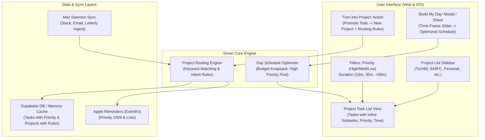

# feat: Project Lists, Smart Routing, Priority/Time Filters, and "Build My Day" Schedule Planner

## Goal Capsule

- **Objective:** Retire the 3x5 physical index cards and freeform desk simulation across both the Web App (`render-webapp`) and iOS Companion (`ios-companion`). Replace them with a high-efficiency Project Workspace where projects are clearly listed out for focused selection, any todo can be converted into a new project, projects contain the intelligence/rules to auto-route incoming todos, tasks support first-class Priority (`High`, `Medium`, `Low`) and Duration selection, and a "Build My Day" scheduler automatically fits High Priority items into the user's chosen time frame.
- **Means:** 
  - Restructure the Web App into a modern, responsive Project Workspace with sidebar navigation, project filtering, rich task rows, inline subtasks, and quick filters.
  - Implement a smart multi-tier project routing engine that evaluates incoming and newly created tasks against each project's keywords and rules.
  - Implement a "Convert Todo to Project" action that promotes any task into an active project and generates routing rules.
  - Implement a knapsack-style "Build My Day" optimizer that takes available time (e.g. 1h, 2h, 4h), packs High Priority tasks (and Medium if time remains), and presents an actionable execution schedule.
  - Update the iOS Companion App (`ios-companion`) to adopt the same project-centric list architecture, priority/time tagging, EventKit priority synchronization, and "Build My Day" sheet.
- **Authority Hierarchy:** User directives > Compound Engineering conventions > Existing codebase patterns.
- **Stop Conditions:** All 9 Implementation Units are completed, verified with TypeScript/build checks on web and compilation checks on iOS, deployed to Render on `main`, and validated end-to-end.

---

## Product Contract

### Problem Frame
The physical index card and 2D canvas drag-and-drop metaphor, while visual, proved too cumbersome for real-world daily productivity. The user wants a clean, list-based system where projects are directly visible and selectable, todos can easily graduate into entire projects, the system intelligently knows which project a new todo belongs to, tasks carry clear priority and time estimates, and the user can ask the system to "build my day" based on how much time they actually have available on their calendar today.

### Requirements

#### R1. Project-Centric Navigation
- The UI shall list all active projects in a dedicated sidebar/panel (Web) and root list view (iOS).
- Selecting a project shall filter the main task list to display only that project's active tasks.
- An "All Tasks" / "Master Inbox" option shall be available to view all active tasks across all projects.
- Each project entry shall display its name, color badge, total active task count, and a badge for High-Priority tasks.

#### R2. Todo-to-Project Promotion
- Every task shall provide an action: "Turn into Project" / "Convert to Project".
- Triggering this action shall open a creation prompt pre-filled with the task's title, allowing color and icon customization.
- Upon confirmation, a new Project shall be created, the originating task (or its subtasks) shall be migrated under the new project, and initial routing keywords derived from the task shall be saved to the project's routing rules.

#### R3. Smart Project Routing Logic
- Each project shall maintain routing logic consisting of keywords, phrases, and pattern rules (stored in `instructions` and `keywords`).
- When a new todo is created (via quick add, daemon sync from Slack/Email, or Letterly voice notes), the routing engine shall evaluate the todo's title and description against all projects' routing rules.
- If a match is found, the todo shall automatically be assigned to that project without manual user sorting.
- If no specific project matches, the todo shall safely fall back to the `General` project.
- Users shall be able to view and edit a project's routing keywords directly from the project settings.

#### R4. Priority and Time Duration Selection
- Every task shall support a `priority` attribute: `high`, `medium`, or `low` (defaulting to `medium`).
- Visual priority indicators shall be displayed on every task:
  - `High`: Red accent / Fire badge (`🔥 High`).
  - `Medium`: Amber/Yellow accent (`⚡ Med`).
  - `Low`: Blue/Green accent (`🌱 Low`).
- Every task shall support an `estimatedMinutes` attribute with intuitive presets: 5m, 15m, 25m, 30m, 45m, 60m, 90m, 120m.
- Users shall be able to change priority and duration with a single click or dropdown on the task row.

#### R5. Multi-Faceted Filtering
- The task workspace shall provide instant filter controls:
  - **By Priority:** `All`, `High`, `Medium`, `Low`.
  - **By Time:** `All`, `Quick (≤15m)`, `Focus (15–30m)`, `Deep Work (>30m)`.
  - **By Project:** Via sidebar selection or dropdown.
  - **By Search:** Instant search by title or subtask text.

#### R6. "Build My Day" Schedule Planner
- The user shall be able to click a "Build My Day" button.
- The user shall select their available working time budget for today (e.g., 60m, 120m, 180m, 240m, or a custom duration).
- The scheduling engine shall:
  1. Filter all active, non-deferred tasks for today.
  2. Prioritize all `High` priority tasks first, fitting them into the available time budget.
  3. If remaining time permits, pack `Medium` priority tasks to maximize time utility.
  4. Generate an ordered focus schedule with estimated start/end durations and total time planned.
- The user shall be able to start working through the generated schedule in a focused, single-task runner mode.

#### R7. Cross-Platform Consistency (Web & iOS)
- Both the Next.js Web App (`render-webapp`) and the SwiftUI iOS App (`ios-companion`) shall reflect these features natively.
- Apple Reminders sync shall map priority bi-directionally (Apple Reminders priority: High = 1–4, Medium = 5, Low = 6–9).
- Changes to projects, routing keywords, priorities, and tasks shall sync reliably across platforms.

---

### Key Flows

- **F1: Selecting a Project to Work On**
  - User opens Web App or iOS App -> Sees list of projects with task counts -> Clicks "Turn90" -> Task view immediately shows all Turn90 tasks, sorted by priority.
- **F2: Converting a Todo to a Project**
  - User sees task "Launch Winter Campaign with crowded" -> Clicks "Turn into Project" -> Dialog confirms Name: "Winter Campaign", picks icon & color -> Clicks "Create Project" -> "Winter Campaign" appears in project list, and task is organized under it with routing rules generated.
- **F3: Ingesting / Adding New Todo with Smart Routing**
  - User types "Buy soccer nets for rec scrimmage" in quick add without picking a project -> Routing engine checks keywords -> Matches "soccer" to 843FC -> Automatically saves to 843FC list.
- **F4: Planning the Day with "Build My Day"**
  - User clicks "Build My Day" -> Selects "2 Hours (120m)" -> Engine selects 3 High Priority tasks (30m + 45m + 25m = 100m) and 1 Quick Medium task (15m = 115m) -> Displays "Today's Focus Plan (4 Tasks • 1h 55m)" -> User clicks "Start Day" and works through them without distraction.

---

### Scope Boundaries

- **In-Scope:**
  - Complete removal of 3x5 draggable card desk canvas in favor of responsive list workspace.
  - Project sidebar / list navigation with counts and indicators.
  - "Turn into Project" feature for any task.
  - Smart keyword and pattern routing engine for incoming/new todos.
  - Priority (`high`, `medium`, `low`) and duration metadata, UI controls, and storage.
  - Priority & duration filtering.
  - "Build My Day" time-budget schedule generator and focus runner.
  - Web App (`render-webapp`) and iOS Companion App (`ios-companion`) implementations.
  - Mac daemon ingestion priority & routing updates.
- **Deferred to Follow-Up Work:**
  - Calendar time-block slotting directly creating `.ics` / Google Calendar events for each task.
  - Drag-and-drop manual reordering across arbitrary project rows.
- **True Non-Goals:**
  - Returning to 3x5 index cards or physical desk canvas.
  - Re-enabling push notification or SMS spam.

---

## Planning Contract

### Key Technical Decisions (KTDs)

- **KTD1: Priority Representation & Reminders Mapping**
  - *Context:* Need high/medium/low priority that syncs cleanly with Apple Reminders and Supabase.
  - *Decision:* Model as `priority: 'high' | 'medium' | 'low'` in TypeScript and Swift. In Apple Reminders (EventKit), map `high` -> 1, `medium` -> 5, `low` -> 9. In task notes, optionally annotate `[🔥 High]`, `[⚡ Med]`, `[🌱 Low]` so backward compatibility with daemon and fallback JSON is seamless.
  - *Consequences:* Seamless 2-way sync with native Apple Reminders app and widgets.
- **KTD2: Project Routing Logic Architecture**
  - *Context:* Projects need the logic to know where new todos belong automatically.
  - *Decision:* Store a `keywords: string[]` list and `instructions: string` on each `Project`. The routing engine runs a scoring heuristic:
    1. Exact keyword/phrase matches (score +10 per match).
    2. Project name/slug token matches (score +5).
    3. Project description/instructions matches (score +2).
    The project with the highest score >= 5 wins; otherwise defaults to `General`.
  - *Consequences:* Zero-latency, deterministic routing on client, server, and daemon.
- **KTD3: "Build My Day" Packing Algorithm**
  - *Context:* Need to build a schedule fitting high-priority items into a chosen time frame.
  - *Decision:* Knapsack-inspired greedy heuristic:
    1. Filter candidates: active, uncompleted, `dueDate` not in future.
    2. Sort candidates by: Priority (High = 3, Med = 2, Low = 1) desc, then estimatedMinutes asc (to maximize tasks accomplished within time), then creation date.
    3. Fill budget: iterate through sorted tasks; if `task.estimatedMinutes <= remainingTime`, add to today's schedule and deduct from remaining budget.
    4. Provide fallback: if no single task fits remaining small delta, pick the smallest available high/med task.
  - *Consequences:* Fast, transparent, predictable daily plan generation without complex external solvers.

---

### High-Level Technical Design

---

## Implementation Units

### U1. Data Model & Schema Updates (Web & Sync)
- **Goal:** Add `priority`, project `keywords`, and routing metadata to `render-webapp` types, fallback datasets, and API endpoints.
- **Requirements:** R4, R7
- **Dependencies:** None
- **Files:**
  - `render-webapp/src/lib/supabase.ts`
  - `render-webapp/src/lib/fallback-todos.json`
  - `render-webapp/src/app/api/desk/route.ts`
- **Approach:**
  1. Add `priority: 'high' | 'medium' | 'low'` to `Task` type in `supabase.ts` (defaulting to `'medium'`).
  2. Add `keywords?: string[]` to `Project` type in `supabase.ts`.
  3. Update `DEFAULT_PROJECTS` with initial routing keywords:
     - `Turn90`: `["turn90", "turn 90", "t90", "reentry", "case notes", "employer", "participant", "curriculum", "briefcase"]`
     - `843FC`: `["843", "843fc", "soccer", "football", "crowded", "fourth wall", "merch", "tournament", "rec", "drills"]`
     - `Book (Memoir) and Synapse`: `["book", "memoir", "synapse", "cbt", "ai engine", "chapter", "writing"]`
     - `Nosa`: `["nosa", "royvi"]`
     - `Personal`: `["personal", "flea", "cats", "health", "dentist", "doctor", "family", "errand"]`
     - `General`: `["general", "workflow", "review"]`
  4. Update `getFallbackTasks` in `supabase.ts` to parse priority from notes (`[🔥 High]`, `[⚡ Med]`, `[🌱 Low]`) or default to `medium`.
  5. Update `/api/desk/route.ts` GET, PATCH, and POST handlers to support `priority` and project `keywords`.
- **Test Scenarios:**
  - TS compilation passes with zero errors.
  - GET `/api/desk` returns tasks with valid `priority` values (`high`, `medium`, `low`).
  - PATCH `/api/desk` updates task priority and persists.

---

### U2. Smart Project Routing Engine & "Convert to Project" Logic
- **Goal:** Create an automated routing function that assigns tasks to projects based on keywords and rules, and implement project creation from a todo.
- **Requirements:** R2, R3
- **Dependencies:** U1
- **Files:**
  - `render-webapp/src/lib/routing.ts`
  - `render-webapp/src/app/api/projects/route.ts`
  - `render-webapp/src/lib/supabase.ts`
- **Approach:**
  1. Create `render-webapp/src/lib/routing.ts`:
     - Implement `scoreProjectMatch(text: string, project: Project): number`.
     - Implement `determineProjectForTask(title: string, description: string | undefined, projects: Project[]): Project`.
     - Extract tokens from title and description, test against `project.keywords`, `project.name`, and `project.slug`.
     - Return highest scoring project, or fallback to `General`.
  2. Implement `createProjectFromTask(task: Task, customName?: string, customColor?: string, customIcon?: string): { project: Project; updatedTask: Task }`:
     - Generates new Project ID, slug, and derives initial keywords from the task title.
     - Updates the task's `projectId` and `listName`.
  3. Create `/api/projects/route.ts` to handle project creation and routing rule updates.
- **Test Scenarios:**
  - Title "Check soccer registration fees" routes to 843FC.
  - Title "Submit participant briefcase evaluation" routes to Turn90.
  - Title "Pick up groceries" routes to Personal.
  - Unmatched title routes to General.
  - Creating project from todo produces a new project with appropriate keywords and reassigns task.

---

### U3. Webapp Project Workspace & Task List View
- **Goal:** Replace the 2D index card desk UI in `render-webapp` with a clean, high-productivity Project Workspace featuring a sidebar and interactive task list.
- **Requirements:** R1, R4
- **Dependencies:** U1, U2
- **Files:**
  - `render-webapp/src/app/page.tsx`
  - `render-webapp/src/components/ProjectSidebar.tsx`
  - `render-webapp/src/components/TaskRow.tsx`
  - `render-webapp/src/components/TaskSubtaskChecklist.tsx`
- **Approach:**
  1. Create `ProjectSidebar.tsx`:
     - Displays "All Tasks" header item with total count.
     - Displays each project with color dot/icon, project name, active task count pill, and high-priority indicator badge (`🔥 count`).
     - Includes "+ New Project" button at bottom.
     - Highlights active selected project.
  2. Create `TaskRow.tsx`:
     - Clean modern row layout:
       - Checkbox for task completion (animates and strikes out).
       - Title with project badge (if viewing "All Tasks").
       - Interactive subtask progress pill (e.g. "2/4 subtasks") that expands inline subtasks.
       - Priority Selector Dropdown / Pill (`🔥 High`, `⚡ Med`, `🌱 Low`) allowing 1-click change.
       - Time Estimate Pill (e.g., `⏱ 15m`, `⏱ 25m`) allowing 1-click change.
       - "Later" button (defers to tomorrow).
       - "Turn into Project" button.
       - "Focus Sprint" (5m timer trigger).
  3. Refactor `render-webapp/src/app/page.tsx`:
     - Remove canvas zoom, pan, 2D coordinates, blotter, and card drag state.
     - Lay out a dual-pane responsive view: Left Sidebar (projects) + Right Main Workspace (filtered task list).
- **Test Scenarios:**
  - Clicking a project filters tasks to only that project's tasks.
  - Clicking "All Tasks" displays tasks from all projects with project tags.
  - Checking a subtask updates subtask state without completing the parent task.
  - Changing priority on a task updates the UI badge immediately and sends PATCH to server.

---

### U4. Webapp Priority & Duration Filtering & "Convert to Project" Modal
- **Goal:** Add instant filter pills for Priority and Duration, search bar, and the interactive modal for turning a todo into a project.
- **Requirements:** R2, R4, R5
- **Dependencies:** U2, U3
- **Files:**
  - `render-webapp/src/app/page.tsx`
  - `render-webapp/src/components/FilterToolbar.tsx`
  - `render-webapp/src/components/ConvertToProjectModal.tsx`
  - `render-webapp/src/components/ProjectSettingsModal.tsx`
- **Approach:**
  1. Create `FilterToolbar.tsx`:
     - Priority filter segmented controls: `All`, `🔥 High`, `⚡ Medium`, `🌱 Low`.
     - Time filter segmented controls: `All`, `≤15m Quick`, `15–30m Focus`, `>30m Deep`.
     - Search input with clear button.
     - Active filter badge indicators.
  2. Create `ConvertToProjectModal.tsx`:
     - Pre-fills project name from selected task title.
     - Lets user customize name, select color swatch, pick icon, and review generated auto-routing keywords.
     - On submit, calls project creation, links task, updates local state, and switches active project.
  3. Create `ProjectSettingsModal.tsx`:
     - Allows user to view and edit the project's routing keywords and goal.
- **Test Scenarios:**
  - Clicking "🔥 High" filters the view to only high-priority tasks.
  - Combining "Turn90" + "High" + "≤15m" accurately filters to the intersection.
  - Clicking "Turn into Project" on a task opens modal with pre-populated name; submitting adds new project to sidebar and moves task.

---

### U5. Webapp "Build My Day" Schedule Builder & Focus Runner
- **Goal:** Implement the time-budget optimizer that takes available hours/minutes, selects top High-Priority tasks, builds an ordered day schedule, and provides a focused execution runner.
- **Requirements:** R6
- **Dependencies:** U3, U4
- **Files:**
  - `render-webapp/src/lib/dayPlanner.ts`
  - `render-webapp/src/components/BuildMyDayModal.tsx`
  - `render-webapp/src/components/DayScheduleView.tsx`
  - `render-webapp/src/app/page.tsx`
- **Approach:**
  1. Create `render-webapp/src/lib/dayPlanner.ts`:
     - Implement `buildDaySchedule(tasks: Task[], availableMinutes: number): DayPlanResult`.
     - Prioritize `high` priority tasks first, then `medium`.
     - Calculate total scheduled minutes, remaining time buffer, and task execution order.
  2. Create `BuildMyDayModal.tsx`:
     - Header: "Build My Day" with clock icon.
     - Time Budget Picker: Preset quick buttons (`1 Hour`, `2 Hours`, `3 Hours`, `4 Hours`, `Full Day (6h)`) + custom minute slider.
     - One-click "Generate My Day" button.
     - Displays the generated schedule:
       - Summary bar: e.g. "3 High Priority • 2 Medium Priority | Total: 1h 55m / 2h 00m budget".
       - Ordered checklist of tasks with their time blocks.
       - "Start Day / Focus Mode" button to begin executing the first task with a timer.
  3. Hook into `page.tsx` top navbar with a prominent "✨ Build My Day" button.
- **Test Scenarios:**
  - Selecting 60m budget when there are two 30m high-priority tasks picks both and hits exactly 60m.
  - High priority tasks take precedence over medium priority tasks.
  - "Start Focus" launches execution runner on the first scheduled task.

---

### U6. iOS Companion App Models & Service Updates
- **Goal:** Update `TaskItem`, `Project`, and service sync layers in `ios-companion` to support priority, duration, project routing keywords, and EventKit priority mapping.
- **Requirements:** R4, R7
- **Dependencies:** None
- **Files:**
  - `ios-companion/ToDoCompanion/Models/TaskItem.swift`
  - `ios-companion/ToDoCompanion/Models/Project.swift`
  - `ios-companion/ToDoCompanion/Services/RemindersManager.swift`
  - `ios-companion/ToDoCompanion/Services/SupabaseService.swift`
- **Approach:**
  1. In `TaskItem.swift`:
     - Add `var priority: String = "medium"` (CodingKeys: `priority`).
     - Add helper enum `PriorityLevel: String, CaseIterable`: `high`, `medium`, `low`.
     - Add computed property `priorityBadge: (title: String, color: Color, icon: String)`.
  2. In `Project.swift`:
     - Add `var keywords: [String]?` (CodingKeys: `keywords`).
     - Add default keyword sets to standard projects.
  3. In `RemindersManager.swift`:
     - Map `priority` to Apple Reminders `EKReminder.priority`:
       - `high` -> 1
       - `medium` -> 5
       - `low` -> 9
     - When reading reminders from EventKit, map priority back:
       - 1...4 -> `high`
       - 5 -> `medium`
       - 6...9 -> `low`
       - 0 -> check notes for `[🔥 High]` / default `medium`.
  4. In `SupabaseService.swift`:
     - Update payload encoding/decoding to include `priority` and `keywords`.
     - Add `createProject(from task: TaskItem, name: String, color: String, icon: String) async`.
- **Test Scenarios:**
  - Swift project compiles with zero errors (`swift build` or `xcodebuild`).
  - Reading a reminder with EKReminder priority 1 assigns `priority = "high"`.
  - Creating a task with `priority = "high"` sets reminder priority to 1 in EventKit.

---

### U7. iOS Companion App Project Workspace & Task List
- **Goal:** Replace the card deck view in `ios-companion` with a native SwiftUI Project Workspace featuring a projects list, task list, priority/time tags, and "Turn into Project" context menu.
- **Requirements:** R1, R2, R4, R5
- **Dependencies:** U6
- **Files:**
  - `ios-companion/ToDoCompanion/Views/Cards/HomeCardStacksView.swift`
  - `ios-companion/ToDoCompanion/Views/Tasks/ProjectWorkspaceView.swift`
  - `ios-companion/ToDoCompanion/Views/Tasks/TaskItemRowView.swift`
  - `ios-companion/ToDoCompanion/Views/Projects/ConvertTaskToProjectSheet.swift`
- **Approach:**
  1. Create `ProjectWorkspaceView.swift` (and wire into `HomeCardStacksView.swift` / `MainTabView.swift`):
     - Section 1: Horizontal or segmented Project selector cards (Turn90, 843FC, Personal, All) with task counts and high-priority counters.
     - Section 2: Filter pills bar (`All`, `🔥 High`, `⚡ Med`, `≤15m`, `15–30m`).
     - Section 3: Vertical `LazyVStack` of clean, native task cards.
  2. Create `TaskItemRowView.swift`:
     - Checkbox, task title, list badge.
     - Interactive priority menu (tap to change High/Med/Low).
     - Duration pill (tap to change duration).
     - Inline subtask checklist disclosure.
     - Swipe actions: Complete (green), Defer Later (orange).
     - Context menu: "Turn into Project", "5-Min Focus Sprint", "Delete".
  3. Create `ConvertTaskToProjectSheet.swift`:
     - Form with pre-populated project title, color picker, icon picker, and "Create Project" action.
- **Test Scenarios:**
  - iOS Companion app compiles and runs.
  - Tapping a project filters the list to that project.
  - Long-pressing a task shows "Turn into Project" and creates the project.
  - Tapping priority badge cycles or presents priority selection.

---

### U8. iOS Companion App "Build My Day" Sheet
- **Goal:** Implement the "Build My Day" schedule planner in the iOS app with duration selection and day plan execution.
- **Requirements:** R6
- **Dependencies:** U6, U7
- **Files:**
  - `ios-companion/ToDoCompanion/Views/Tasks/BuildMyDaySheet.swift`
  - `ios-companion/ToDoCompanion/Views/Tasks/ProjectWorkspaceView.swift`
- **Approach:**
  1. Create `BuildMyDaySheet.swift`:
     - Time budget selector (1h, 2h, 3h, 4h, or custom stepper).
     - Schedule generation algorithm in Swift (mirroring `dayPlanner.ts`).
     - Visual schedule summary with High/Med task breakdown.
     - "Start Focus" button opening `SingleStepFocusView` for the first task.
  2. Add prominent "Build My Day" toolbar button with sparkle icon to `ProjectWorkspaceView`.
- **Test Scenarios:**
  - Tapping "Build My Day" opens sheet with budget selector.
  - Selecting 2 hours populates schedule with top high-priority tasks totaling <= 120 minutes.
  - Tapping "Start Focus" launches execution runner on top task.

---

### U9. Mac Daemon Ingest Priority & Smart Routing
- **Goal:** Update the hourly background daemon (`mac-daemon`) to parse priority and route new todos to projects using keywords.
- **Requirements:** R3, R4
- **Dependencies:** U1, U2
- **Files:**
  - `mac-daemon/sync.js`
  - `mac-daemon/ai.js`
  - `mac-daemon/reminders.js`
- **Approach:**
  1. In `mac-daemon/ai.js`:
     - Update prompt to extract `priority` (`high` for urgent/critical tasks, `medium` for standard, `low` for backlog).
     - Update prompt to match against project keywords.
  2. In `mac-daemon/sync.js`:
     - Apply multi-tier project routing using project keyword definitions.
     - Write priority tags into reminder notes (`[🔥 High]`) and pass priority to `addReminder`.
  3. In `mac-daemon/reminders.js`:
     - Pass priority to `add_reminder` Swift script.
- **Test Scenarios:**
  - Ingesting a task mentioning "urgent sponsor outreach" marks priority `high` and routes to 843FC.
  - Daemon restart succeeds via PM2 (`pm2 restart daily-planner-sync`).

---

## Verification Contract

### Automated Verification
- `cd render-webapp && npm run build` (Next.js build, TypeScript compiler, Turbopack bundling) -> Must pass with 0 errors.
- `cd ios-companion && swift build` (or Xcode build test) -> Must pass with 0 errors.
- `node mac-daemon/test-find.js` / daemon syntax check -> Must pass with 0 errors.

### Manual / Integration Verification Scenarios
1. **No Index Cards Check:** Open Web App in browser -> Verify no 3x5 cards or 2D canvas; verify clean project list workspace.
2. **Project Selection Check:** Click "Turn90" in sidebar -> Verify only Turn90 tasks appear. Click "All Tasks" -> Verify all tasks appear with project badges.
3. **Smart Routing Check:** Create a new todo with title "Order training cones for rec league" -> Verify it automatically routes to 843FC without selecting a project.
4. **Convert to Project Check:** Click "Turn into Project" on a task -> Confirm dialog -> Verify new project appears in sidebar and task belongs to it.
5. **Priority & Duration Check:** Change task priority to "High" -> Verify red fire badge appears; reload page -> Verify priority persists.
6. **Filtering Check:** Click "🔥 High" filter -> Verify only high-priority tasks are visible. Click "≤15m" -> Verify only quick tasks are visible.
7. **"Build My Day" Check:** Click "Build My Day", select 120 minutes -> Verify High Priority items are scheduled first, total minutes <= 120m, and "Start Focus" opens runner.
8. **Git & Deploy Check:** Commit changes, push to `feat/ios-companion-app` and merge to `main`, verify Render builds and deploys successfully.

---

## Definition of Done

- [ ] All 9 Implementation Units completed and verified.
- [ ] Physical index card UI completely replaced by responsive Project Workspace in both Web and iOS apps.
- [ ] Projects listed out with task counts and one-click selection.
- [ ] Ability to create a project from any todo.
- [ ] Projects have automatic routing logic (keywords/rules) to place new incoming todos.
- [ ] Priority (`high`, `medium`, `low`) and time selection supported and displayed on all todos.
- [ ] Multi-faceted filtering by priority, time, and project.
- [ ] "Build My Day" dynamic schedule planner operational and tested.
- [ ] Tested and deployed to Render via `main` branch.
